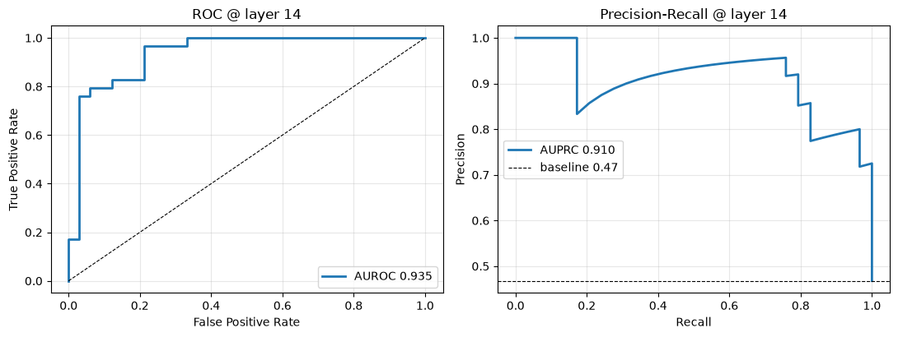

# M.U.T.E - Middle-layer Uncertainty Threshold Engine (in experiment)
### Can a small LLM detect when it's about to guess — before it says a word?

**What if we could check whether an LLM has the information it needs before letting it answer?**

Small language models can confidently produce a price, date, or order number that was never actually provided. Telling them *"don't make things up"* is not a particularly robust security strategy.

This project explores a different approach: inspect a language model's internal representations before text generation begins, use a lightweight linear probe to estimate missing-context risk, and stop decoding when that risk crosses a configurable threshold.

Think of it as a tiny bouncer at the door of token generation.

> **Status:** Experimental proof of concept. Results are preliminary and task-specific; this is not a general-purpose hallucination detector.

## The Idea in 30 Seconds

Imagine an email says:

> Order #1500 confirmed. Delivery address: 12 Example Street.

You are asked to extract the total price. The email never mentions one.

A language model may still produce a plausible-looking number. The problem is not whether the number looks reasonable — it's whether the source actually supports it.

This experiment asks whether a small classifier can identify signals associated with missing information inside the model's intermediate representations, before the model starts generating an answer.

- **Information missing?** The probe may flag elevated risk and trigger abstention.
- **Information supplied?** The probe may assign a lower risk score and allow normal generation.

The intended behavior is simple: when the model lacks the requested information, prefer an explicit abstention over an unsupported guess.

*Illustrative example: actual detection performance depends on the input, threshold, and generalization of the trained probe.*

## How It Works

The circuit breaker has three main stages:

1. **Read the input.** The LLM processes the prompt during its prefill pass.
2. **Inspect its internal representation.** A linear probe reads a hidden-state vector from a selected Transformer layer and estimates whether the input resembles missing-context cases in its training data.
3. **Decide whether to proceed.** If the score crosses a configured threshold, the generation pipeline can abstain before producing answer tokens. Otherwise, normal generation proceeds.

The base model remains frozen. The probe is trained separately as a lightweight classifier.

### Architecture

```text
Input prompt
     |
     v
LLM prefill pass
     |
     v
Selected intermediate hidden state
     |
     v
Trained linear probe
     |
     v
Risk score
     |
     +---- Above threshold ----> Abort decoding / abstain
     |
     +---- Below threshold ---> Continue normal generation
```

**Important distinction:** Extracting an intermediate hidden state does not automatically stop the model from computing later layers. Genuine early-exit inference requires an implementation that actually skips those layers.

## Experimental Setup

| Component | Details |
|---|---|
| Base model | `Qwen/Qwen3.5-0.8B` |
| Detection method | Linear probe using logistic regression |
| Target task | Detecting missing-context risks in structured information extraction |
| Evaluation | Five-fold cross-validation |
| Layer analysis | Embedding output and 24 Transformer blocks |
| Decision mechanism | Configurable score threshold |
| Base-model fine-tuning | None |

The initial experiment trained a probe on 20 constructed examples. A subsequent experiment expanded the dataset to 40 examples and evaluated probes across all 25 hidden-state indices.

## Results So Far

### 1. Layer-wise probe accuracy

The layer sweep found that multiple intermediate layers achieved 100% five-fold cross-validation accuracy on the current experimental dataset. Layer 23 was selected as the best-performing layer by the experiment's selection logic.

The initial runtime demonstration uses a Layer 15 probe. These are separate experimental configurations, not contradictory claims: the initial demonstration and the later layer sweep serve different purposes.

**What this suggests:** Information useful for this particular classification task may be linearly accessible in intermediate model representations.

**What it does not establish:** That the probe can detect hallucinations reliably across arbitrary prompts, domains, or models.

> A perfect score on a small dataset is a reason to investigate further, not a reason to stop testing.

### 2. Counterfactual tests

The notebook also tests what happens when missing information is added back into selected inputs.

| Test case | Missing-information score | After adding the fact |
|---|---:|---:|
| Renewal price | 0.879 | 0.009 |
| Revised quote total | 0.973 | 0.010 |
| Quoted price | 0.820 | 0.002 |

These examples show a substantial score reduction after the relevant information is supplied.

This is encouraging because it suggests the probe may be responding to changes in the input rather than simply assigning every example a fixed risk score.

However, these are a small number of constructed counterfactual pairs. Further tests are needed to rule out sensitivity to wording, templates, distractor numbers, and other surface-level features.

**Interpret the scores carefully:** They are outputs of the trained classifier, not automatically calibrated probabilities of real-world hallucination.

### 3. Real-world benchmark: CUAD commercial contracts

The constructed emails are a nice warm-up, but the real test is whether the signal survives real-world text. The notebook now runs the probe against [**CUAD**](https://www.atticusprojectai.org/cuad) — 510 expert-labeled commercial contracts with human-annotated answers — using 300 questions: 150 where the answer is present, 150 where it is genuinely absent.

| Metric | Value |
|---|---:|
| Blind-test AUROC | **0.950** (95% CI 0.882–0.993) |
| Blind-test AUPRC | **0.940** (chance ≈ 0.52) |
| Selected layer | 14 (chosen on the train split only) |

And the part that actually matters for a circuit breaker — what you get when the threshold is set by an acceptable false-block budget:

| Allowed false-block rate | Missing-answer caught | Precision |
|---|---:|---:|
| ≤10% | 71% | 96% |
| ≤20% | 81% | 89% |

So: at a threshold that blocks at most ~10% of normal questions, the probe catches ~7 out of 10 "this information isn't in the text" cases. That's the difference between a bouncer who occasionally dozes off and one who actually checks the guest list.

**Caveat:** these are *gold-labeled* contracts, so no auto-labeling noise inflates the number.

**Position-shortcut check:** because answerable windows center the answer while unanswerable ones are arbitrary slices, a probe could cheat by learning "the relevant text sits in the middle." Randomizing the answer's position inside the window gives **AUROC 0.935 / AUPRC 0.910** — essentially unchanged from 0.950 / 0.940 — so the signal is about *presence*, not position.



## Why This Approach?

Conventional approaches to reducing hallucinations include prompt engineering, retrieval-augmented generation (RAG), output validation, and separate model-based judges.

This experiment investigates a complementary option: using information already present in the model's internal representations to make an additional pre-generation decision.

Potential advantages worth investigating:

- **No second LLM judge:** The classifier itself is lightweight.
- **No base-model fine-tuning:** The original model weights remain unchanged.
- **Potentially low additional overhead:** Linear classification is inexpensive compared with another full model invocation, although the full pipeline must still be benchmarked.
- **A natural abstention mechanism:** The system can decline to answer when the probe detects elevated missing-context risk.

These are potential engineering advantages, not yet demonstrated end-to-end performance guarantees.

## What This Project Does Not Claim

This is an experimental missing-context detector, not a universal truth detector.

- It does not detect every kind of hallucination.
- It does not prove that a proposed answer is factually correct.
- It shows a signal on one gold-labeled domain (commercial contracts), not generalization to arbitrary real-world workloads.
- It does not establish that Layer 23 is universally optimal.
- It does not guarantee that every risky generation will be blocked.

A probe can only learn patterns represented in its training data. If the real-world failure differs from those patterns, the detector may miss it.

## Reproducing the Experiment

The notebook contains the experimental workflow, including data construction, hidden-state extraction, probe training, layer-wise evaluation, and counterfactual tests.

**Notebook:** [Open the experiment in GitHub](./Small_language_Model_Qwen_3_5_0_k_hallucination_probe_experiment_.ipynb)

To reproduce the results:

1. Open the notebook in an environment that supports the required Python dependencies and model download.
2. Run the cells in order.
3. Review the sample construction and label definitions before interpreting accuracy.
4. Inspect the cross-validation results and selected layer.
5. Run the counterfactual examples and verify the risk-score changes.

Exact dependencies are pinned in [`requirements.txt`](./requirements.txt); hardware requirements and execution times are noted in the notebook.

## Limitations and Next Steps

The next stage is to determine whether the observed signal generalizes beyond the constructed examples.

1. **Wider evaluation:** CUAD is one domain; test across more document types (emails, tickets, RAG evidence) to see where the signal holds — and where it quietly gives up.
2. **Robustness testing:** Vary wording, entity names, distractor numbers, dates, and source attribution.
3. **Better metrics:** Report precision, recall, false-positive rate, and threshold sensitivity, alongside accuracy.
4. **Baseline comparisons:** Compare against simple text-based classifiers and relevant abstention or verification methods.
5. **Actual early-exit inference:** Implement a forward pass that stops at the selected layer, then benchmark end-to-end latency, throughput, and memory.
6. **Broader task evaluation:** Investigate whether the approach extends to RAG evidence sufficiency or other narrowly defined reliability tasks.

## Final Thought

LLMs are very good at producing answers. Knowing when not to answer is a different problem.

This project explores whether a small, inexpensive classifier can help make that distinction before generation begins.

It is an early experiment, not a finished safety solution — and the next challenge is to find out where the idea holds up when the data gets harder.

**Contributions, criticism, and reproducible counterexamples are welcome.**
